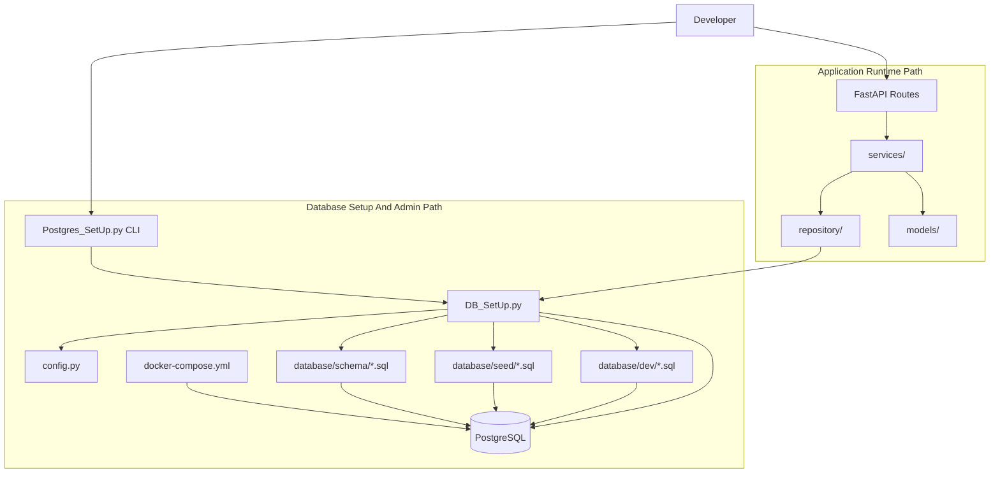
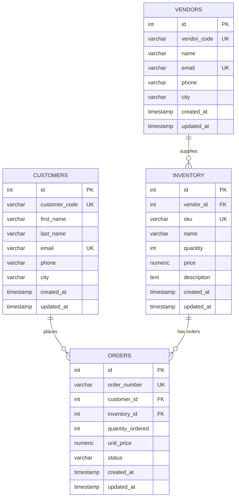
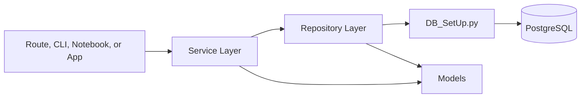

# PostgreSQL Data Project Template

This project is a reusable PostgreSQL starter template for local data projects,
backend services, experiments, and small applications that need a database setup
they can copy into another codebase.

The main goal is to make PostgreSQL easy to:

- start locally with Docker
- configure with environment variables
- initialize with ordered schema files
- seed with repeatable sample data
- reset during development
- use from Python code through a small reusable connection helper

## Project Structure

```text
PostgresSQl_setup/
  DB_SetUp.py
  Postgres_SetUp.py
  config.py
  logging_config.py
  docker-compose.yml
  .env.example
  requirements.txt
  api/
    __init__.py
    main.py
    schemas.py
  database/
    schema/
      001_create_inventory_table.sql
      002_add_inventory_description_column.sql
      003_create_orders_table.sql
      004_create_customers_table.sql
      005_create_vendors_table.sql
      006_add_inventory_vendor_id.sql
      007_add_orders_customer_id.sql
    seed/
      000_customers_seed.sql
      000_vendors_seed.sql
      001_inventory_seed.sql
      002_orders_seed.sql
      003_update_inventory_item.sql
    dev/
      reset_inventory.sql
  repository/
    __init__.py
    customers_repo.py
    inventory_repo.py
    orders_repo.py
    vendors_repo.py
  services/
    __init__.py
    customers_service.py
    inventory_service.py
    orders_service.py
    vendors_service.py
  models/
    __init__.py
    customer.py
    inventory.py
    order.py
    vendor.py
  scripts/
    smoke_test_api.py
  docs/
    audits/
    templates/
      TEMPLATE_2_STREAMLIT_DASHBOARD.md
  utils/
```

## Core Template Files

These files are the reusable PostgreSQL template:

- `docker-compose.yml` starts PostgreSQL locally.
- `.env.example` documents required database variables.
- `config.py` loads `.env` values and validates database config.
- `logging_config.py` configures shared logging.
- `DB_SetUp.py` provides reusable Python database helpers.
- `Postgres_SetUp.py` provides command-line setup commands.
- `database/schema` stores ordered schema scripts.
- `database/seed` stores ordered seed and update scripts.
- `database/dev` stores local-only reset scripts.
- `api/` exposes the implemented runtime path through FastAPI endpoints.

## Implemented Sample App Layer

These folders are now set up as a working `customers`, `vendors`, `inventory`,
and `orders` sample app. They show how a real codebase can sit on top of the
reusable PostgreSQL template:

- `api/` contains FastAPI routes and request schemas.
- `repository/` contains raw SQL data-access functions.
- `services/` contains business workflows and validation.
- `models/` contains Python representations of database objects.
- `utils/` is for small shared helpers.

For a pure database template, these folders are not strictly required. In this
project, they are intentionally included to demonstrate the recommended app
architecture.

## Quick Start

Create a local `.env` file:

```powershell
Copy-Item .env.example .env
```

Edit `.env` and set your database password.

Create and activate a virtual environment:

```powershell
py -m venv .venv
.\.venv\Scripts\Activate.ps1
pip install -r requirements.txt
```

Start PostgreSQL:

```powershell
docker compose up -d
```

Fix Option: Reset Docker Volume

If you change database environment variables after the container already exists,
especially `DB_NAME`, reset the Docker volume before checking the connection.
For example, changing from the default `postgres` database to a project database
like `EcommerceStore` will not automatically create the new database inside an
already-initialized Postgres volume.

This reset deletes the local Docker database volume and recreates PostgreSQL
using the current `.env` values:

```powershell
docker compose down -v
docker compose up -d
```

Check the database connection:

```powershell
py Postgres_SetUp.py check
```

Create tables:

```powershell
py Postgres_SetUp.py init
```

Create tables and seed data:

```powershell
py Postgres_SetUp.py init --with-seed
```

Run seed scripts only:

```powershell
py Postgres_SetUp.py seed
```

Reset local development tables:

```powershell
py Postgres_SetUp.py reset
```

Run the example inventory/order service flow:

```powershell
py Postgres_SetUp.py demo
```

Run the FastAPI backend:

```powershell
uvicorn api.main:app --reload
```

Open the interactive API docs:

```text
http://127.0.0.1:8000/docs
```

In a second terminal, run the endpoint smoke test:

```powershell
py scripts/smoke_test_api.py
```

## Command Reference

| Command | Purpose |
| --- | --- |
| `py Postgres_SetUp.py check` | Tests the PostgreSQL connection. |
| `py Postgres_SetUp.py init` | Runs all files in `database/schema` in filename order. |
| `py Postgres_SetUp.py init --with-seed` | Runs schema files, then seed files. |
| `py Postgres_SetUp.py seed` | Runs all files in `database/seed` in filename order. |
| `py Postgres_SetUp.py reset` | Runs development reset scripts. |
| `py Postgres_SetUp.py demo` | Runs the implemented inventory/order service demo. |

## FastAPI Runtime Endpoints

FastAPI is the runtime entry point for testing the application layer:

```text
FastAPI -> Services -> Repositories -> DB_SetUp.py -> PostgreSQL
```

Current endpoint groups:

| Method | Path | Purpose |
| --- | --- | --- |
| `GET` | `/health` | Check PostgreSQL connectivity. |
| `GET` | `/customers` | List customers. |
| `POST` | `/customers` | Create a customer. |
| `GET` | `/customers/{customer_code}` | Get one customer. |
| `PUT` | `/customers/{customer_code}` | Update a customer. |
| `DELETE` | `/customers/{customer_code}` | Delete a customer. |
| `GET` | `/vendors` | List vendors. |
| `POST` | `/vendors` | Create a vendor. |
| `GET` | `/vendors/{vendor_code}` | Get one vendor. |
| `PUT` | `/vendors/{vendor_code}` | Update a vendor. |
| `DELETE` | `/vendors/{vendor_code}` | Delete a vendor. |
| `GET` | `/inventory` | List inventory, or search with `?q=value`. |
| `POST` | `/inventory` | Create inventory supplied by an optional vendor. |
| `GET` | `/inventory/{sku}` | Get one inventory item. |
| `PUT` | `/inventory/{item_id}` | Update one inventory item. |
| `DELETE` | `/inventory/{item_id}` | Delete one inventory item. |
| `GET` | `/orders` | List orders with customer and inventory details. |
| `POST` | `/orders` | Place an order for a customer and reduce inventory stock. |
| `GET` | `/orders/{order_number}` | Get one order. |
| `PATCH` | `/orders/{order_number}/status` | Update order status. |
| `DELETE` | `/orders/{order_number}` | Delete one order. |

### FastAPI Smoke Test Flow

The smoke test in `scripts/smoke_test_api.py` checks the full runtime path:

```text
FastAPI -> Services -> Repositories -> DB_SetUp.py -> PostgreSQL
```

It creates:

- one vendor
- one customer
- one inventory item connected to the vendor
- one order connected to the customer and inventory item

Then it reads the created order and lists order details.

## Template Blueprint



The setup/admin path can use `DB_SetUp.py` directly because commands like
`init`, `seed`, and `reset` are database lifecycle tasks. The application
runtime path should go through `services/` first, then `repository/`, then
`DB_SetUp.py`.

## Database Blueprint



## SQL File Pattern

Schema files should be additive and ordered:

```text
001_create_inventory_table.sql
002_add_inventory_description_column.sql
003_create_orders_table.sql
004_create_customers_table.sql
005_create_vendors_table.sql
006_add_inventory_vendor_id.sql
007_add_orders_customer_id.sql
```

Seed files should also be ordered:

```text
000_customers_seed.sql
000_vendors_seed.sql
001_inventory_seed.sql
002_orders_seed.sql
003_update_inventory_item.sql
```

The current seed setup creates:

- 40 customers
- 10 vendors
- 75 inventory items
- 120 orders connected to inventory items
- 1 follow-up inventory item update for `SKU001`

Prefer repeatable SQL when possible:

- Use `CREATE TABLE IF NOT EXISTS`.
- Use `ADD COLUMN IF NOT EXISTS`.
- Use `ON CONFLICT` for seed data.
- Use stable lookup columns like `sku` or `order_number`.

## Current Tables

### `customers`

Stores people or accounts buying inventory items.

Important columns:

- `id`: primary key
- `customer_code`: unique customer code
- `first_name`: customer first name
- `last_name`: customer last name
- `email`: unique customer email
- `phone`: optional phone number
- `city`: optional city
- `created_at`: row creation timestamp
- `updated_at`: row update timestamp

### `vendors`

Stores suppliers providing inventory items.

Important columns:

- `id`: primary key
- `vendor_code`: unique vendor code
- `name`: vendor name
- `email`: unique vendor email
- `phone`: optional phone number
- `city`: optional city
- `created_at`: row creation timestamp
- `updated_at`: row update timestamp

### `inventory`

Stores products or stock items.

Important columns:

- `id`: primary key
- `vendor_id`: optional foreign key to `vendors(id)`
- `sku`: unique item code
- `name`: item name
- `quantity`: available stock
- `price`: item price
- `description`: optional item description
- `created_at`: row creation timestamp
- `updated_at`: row update timestamp

### `orders`

Stores orders connected to inventory items.

Important columns:

- `id`: primary key
- `order_number`: unique order code
- `customer_id`: optional foreign key to `customers(id)`
- `inventory_id`: foreign key to `inventory(id)`
- `quantity_ordered`: number of units ordered
- `unit_price`: price used on the order
- `status`: order state
- `created_at`: row creation timestamp
- `updated_at`: row update timestamp

## Example Join Query

Use this to check that orders are connected to inventory:

```sql
SELECT
    orders.order_number,
    customers.customer_code,
    customers.first_name || ' ' || customers.last_name AS customer_name,
    inventory.sku,
    inventory.name,
    vendors.vendor_code,
    vendors.name AS vendor_name,
    orders.quantity_ordered,
    orders.unit_price,
    orders.status
FROM orders
JOIN inventory ON inventory.id = orders.inventory_id
LEFT JOIN customers ON customers.id = orders.customer_id
LEFT JOIN vendors ON vendors.id = inventory.vendor_id
ORDER BY orders.order_number;
```

Check the seed counts:

```sql
SELECT COUNT(*) AS customer_count FROM customers;
SELECT COUNT(*) AS vendor_count FROM vendors;
SELECT COUNT(*) AS inventory_count FROM inventory;
SELECT COUNT(*) AS order_count FROM orders;
```

## Use In Python

For normal application workflows, use the service layer first. Use `DB_SetUp.py`
directly for setup scripts, health checks, one-off admin tasks, or low-level
database utilities.

Use the managed connection helper when you want automatic commit, rollback, and
close behavior:

```python
from DB_SetUp import get_connection


with get_connection() as connection:
    with connection.cursor() as cursor:
        cursor.execute("SELECT version();")
        print(cursor.fetchone()[0])
```

Initialize the database from another script:

```python
from DB_SetUp import initialize_database


initialize_database(with_seed=True)
```

Use the raw connection helper when your code wants to control transactions:

```python
from DB_SetUp import connect


connection = connect()
try:
    with connection.cursor() as cursor:
        cursor.execute("SELECT 1;")
    connection.commit()
finally:
    connection.close()
```

## Repository, Service, And Models

The implemented sample app layer follows this responsibility split:



### Repository

Repository files should contain database access only:

- SQL queries
- inserts
- updates
- deletes
- row fetching
- transaction-safe database operations

Example:

```text
repository/customers_repo.py
repository/inventory_repo.py
repository/orders_repo.py
repository/vendors_repo.py
```

Current repository responsibilities:

- `customers_repo.py` handles customer CRUD and lookup.
- `inventory_repo.py` handles item CRUD, item lookup, item search, and stock quantity updates.
- `orders_repo.py` handles order CRUD, order lookup, status updates, and order detail joins.
- `vendors_repo.py` handles vendor CRUD and lookup.

Repositories should not call `commit()` or `rollback()` directly. The service
or database helper owns transactions so multi-step workflows can succeed or
fail as one unit.

### Service

Service files should contain business rules:

- check whether inventory has enough stock
- create an order for a customer and reduce inventory in one transaction
- connect inventory items to vendors
- validate inputs before calling repository functions
- coordinate multiple repositories

Example:

```text
services/customers_service.py
services/inventory_service.py
services/orders_service.py
services/vendors_service.py
```

Current service responsibilities:

- `CustomerService` validates and manages customers.
- `VendorService` validates and manages vendors.
- `InventoryService` validates item input, resolves vendor codes, and wraps inventory repository calls.
- `OrderService` places customer orders, checks stock, creates the order, and reduces inventory in one transaction.

### Models

Model files should contain Python representations of data:

```python
from dataclasses import dataclass
from datetime import datetime
from decimal import Decimal


@dataclass
class InventoryItem:
    id: int
    sku: str
    name: str
    quantity: int
    price: Decimal
    description: str | None
    vendor_id: int | None
    created_at: datetime
    updated_at: datetime
```

Models are part of the sample app layer and make repository/service return
values easier to understand than raw tuples.

Current models:

- `Customer`
- `InventoryItem`
- `Order`
- `OrderWithDetails`
- `OrderWithInventory`
- `Vendor`

## Service Usage Example

Use services from application code instead of calling repositories directly:

```python
from services.customers_service import CustomerService
from services.inventory_service import InventoryService
from services.orders_service import OrderService
from services.vendors_service import VendorService


customer_service = CustomerService()
inventory_service = InventoryService()
order_service = OrderService()
vendor_service = VendorService()

vendor = vendor_service.create_vendor(
    vendor_code="VEN-100",
    name="Example Supplier",
    email="vendor100@example.com",
)

customer = customer_service.create_customer(
    customer_code="CUS-100",
    first_name="Example",
    last_name="Customer",
    email="customer100@example.com",
)

item = inventory_service.create_item(
    sku="SKU100",
    name="Monitor",
    quantity=12,
    price=3500.00,
    description="27 inch display",
    vendor_code=vendor.vendor_code,
)

order = order_service.place_order(
    order_number="ORD-100",
    customer_code=customer.customer_code,
    sku=item.sku,
    quantity_ordered=2,
    status="paid",
)

print(order.total_price)
```

## Project Audits

Project development is tracked in [AUDIT_LOG.md](AUDIT_LOG.md).

Use the audit trail to document:

- schema changes
- seed data changes
- service, repository, and model changes
- architecture decisions
- README and diagram changes
- bugs, fixes, and verification results
- ideation growth and co-creation notes

Current audit entries live in `docs/audits/`. Use
`docs/audits/AUDIT_TEMPLATE.md` when adding a new audit entry.

## Future Template 2

Streamlit dashboards are intentionally not included in this backend template.
The planned next template is documented in
`docs/templates/TEMPLATE_2_STREAMLIT_DASHBOARD.md`.

That future project should follow this path:

```text
Streamlit Dashboard -> FastAPI API -> Services -> Repositories -> PostgreSQL
```

## Docker Commands

```powershell
docker compose ps
docker compose logs postgres
docker compose stop
docker compose start
docker compose down
```

Remove the database volume and all local data:

```powershell
docker compose down -v
```

## Reusing This Template

To embed only the core PostgreSQL template into another Python project, copy:

- `DB_SetUp.py`
- `config.py`
- `logging_config.py`
- `database/`
- `.env.example`
- `docker-compose.yml`
- the dependencies from `requirements.txt`

To also include the sample app architecture, copy:

- `api/`
- `models/`
- `repository/`
- `services/`

Then replace or extend the sample `inventory` and `orders` domain with your
project's tables and workflows.
