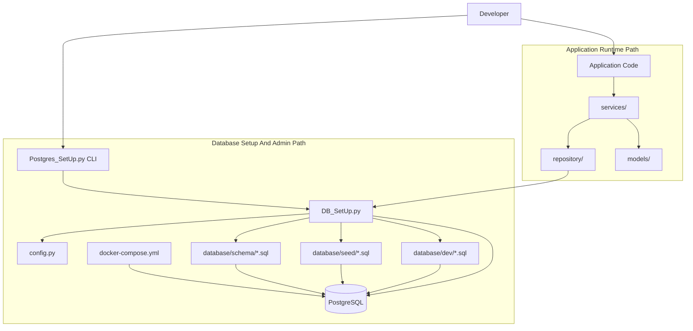
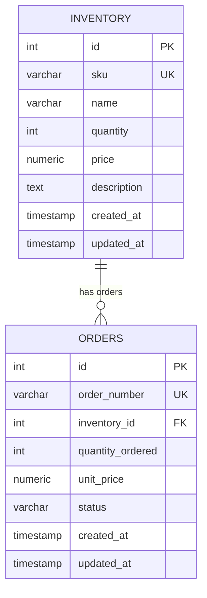

# 2026-08-19 Project Development Audit

## Purpose

Document the project growth so far: the original idea, the architecture
decisions made during co-creation, the files that changed, and the current
direction of the PostgreSQL data project template.

This audit is reconstructed from the current project state and the design
conversation up to 2026-08-19.

## Starting Point

The project began as a small PostgreSQL setup with:

- one connection helper in `DB_SetUp.py`
- a procedural demo script in `Postgres_SetUp.py`
- basic `.env`-driven config
- an `inventory` table
- early inventory repository functions
- placeholder service/model folders
- setup notes in `README.md`

The original user goal was to make the PostgreSQL setup reusable so it could be
spun up quickly or embedded into another codebase.

## Major Development Phases

### Phase 1: Reusable PostgreSQL Core

The setup was reshaped from a one-off script into a reusable template.

Implemented:

- `PostgresDB` helper in `DB_SetUp.py`
- backward-compatible `connect()`
- `get_connection()` context manager
- `initialize_database()`
- SQL directory runners for schema and seed scripts
- configuration validation in `config.py`
- `docker-compose.yml`
- `.env.example`
- command-line actions in `Postgres_SetUp.py`

Key decision:

`DB_SetUp.py` should be low-level infrastructure. It should know how to connect,
run SQL files, and manage transactions, but it should not contain app-specific
business rules.

### Phase 2: Schema And Seed Lifecycle

The database moved toward a simple migration-like structure:

```text
database/
  schema/
  seed/
  dev/
```

Implemented schema files:

- `001_create_inventory_table.sql`
- `002_add_inventory_description_column.sql`
- `003_create_orders_table.sql`

Implemented seed/dev files:

- `001_inventory_seed.sql`
- `002_orders_seed.sql`
- `003_update_inventory_item.sql`
- `dev/reset_inventory.sql`

Key decisions:

- Schema files should be ordered and additive.
- Seed files should be repeatable.
- Seeds should use `ON CONFLICT` where possible.
- Foreign-key seed data should use stable lookup columns like `sku`, not hardcoded IDs.

### Phase 3: Inventory And Orders Relationship

The template gained a real relational example:

```text
inventory ||--o{ orders
```

Implemented:

- `orders.inventory_id` foreign key to `inventory.id`
- order seeds that connect to inventory rows
- reset ordering that drops `orders` before `inventory`
- join-query documentation in the README

Key decision:

`orders` should connect to the real inventory primary key, but seed scripts
should find inventory rows through stable business identifiers like `sku`.

### Phase 4: README As Project Blueprint

The README was rewritten from notes into a template guide.

Documented:

- project purpose
- folder responsibilities
- quick start
- command reference
- Mermaid architecture diagrams
- Mermaid entity relationship diagram
- SQL file pattern
- seed counts
- Python usage examples
- service/repository/model responsibilities
- reuse instructions

Key decision:

The README should be both a setup guide and an architecture map, not only a
command list.

### Phase 5: Implemented App Layer

The earlier `repository`, `services`, and `models` folders were first discussed
as optional, then built into a real sample app layer.

Implemented models:

- `models/inventory.py`
- `models/order.py`
- `models/__init__.py`

Implemented repositories:

- `repository/inventory_repo.py`
- `repository/orders_repo.py`
- `repository/__init__.py`

Implemented services:

- `services/inventory_service.py`
- `services/orders_service.py`
- `services/__init__.py`

Key decision:

The sample app layer is now implemented, but the reusable PostgreSQL core still
stands on its own. A future project can copy only the core template or copy the
core plus the sample app architecture.

### Phase 6: Service vs Repository Boundary

The architecture was clarified.

Repository responsibilities:

- run SQL
- fetch rows
- insert/update/delete records
- return typed models where useful
- avoid owning commits/rollbacks

Service responsibilities:

- validate inputs
- coordinate workflows
- enforce business rules
- call one or more repositories
- rely on the database helper for transaction boundaries

Key decision:

Normal application code should call services first. Repositories should not be
the main entry point for application workflows.

Current application flow:

```text
Application Code -> Services -> Repositories -> DB_SetUp.py -> PostgreSQL
```

Setup/admin flow:

```text
Postgres_SetUp.py CLI -> DB_SetUp.py -> schema/seed/dev SQL -> PostgreSQL
```

### Phase 7: Larger Seed Dataset

The seed files were expanded from tiny examples to a richer dataset.

Current expected seed result:

- 75 inventory items
- 120 orders
- one follow-up update for `SKU001`

Key decision:

Bulk seed data should be generated in SQL using `generate_series`, not copied as
hundreds of hand-written `INSERT` statements.

## Current Architecture



## Current Database Design



## Verification Completed

Completed from the sandbox:

- Python syntax compilation for the new models, repositories, services, and CLI.
- CLI help check for `Postgres_SetUp.py`.
- Docker Compose configuration parse check earlier in the build.
- SQL file placement and ordering checks.

Not completed from the sandbox:

- Live database seed execution.
- Live service demo execution.

Reason:

The project virtual environment executable was blocked by Windows sandbox
permissions, and the bundled Codex Python did not include `psycopg2`.

## Known Notes And Risks

- `.env` contains local credentials and should remain ignored by git.
- The `.vscode/PythonImportHelper-v2-Completion.json` file appeared modified
  during earlier status checks, but it was not intentionally edited as part of
  the architecture work.
- Repositories now avoid direct commits/rollbacks so services can coordinate
  multi-step workflows safely.
- The README had an architecture mismatch where application code appeared to
  connect directly to `DB_SetUp.py`; this was corrected by separating setup/admin
  flow from runtime app flow.

## Ideation Growth

The idea grew through these stages:

1. A simple PostgreSQL connection/demo script.
2. A reusable database setup utility.
3. A local Docker-backed data project template.
4. A repeatable schema/seed lifecycle.
5. A relational inventory/orders example.
6. A documented blueprint with Mermaid diagrams.
7. A real app-layer example using services, repositories, and models.
8. A larger generated dataset for more realistic development and testing.
9. A project audit trail to preserve decisions and co-creation history.

## Next Good Steps

- Run `py Postgres_SetUp.py init --with-seed` from the normal project terminal.
- Confirm seed counts with SQL queries.
- Run `py Postgres_SetUp.py demo`.
- Add tests for service workflows.
- Add `orders_service` tests for insufficient stock and duplicate order numbers.
- Decide whether to keep the sample app layer in the template or move it under
  an `examples/` folder later.
